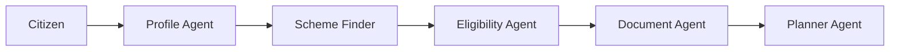

# 🇮🇳 BharatAssist AI

Multi-Agent Citizen Welfare Navigator

## Problem

Millions of Indian citizens struggle to discover and apply for government welfare schemes.

## Solution

BharatAssist AI uses an agent-based architecture to:

- Profile citizens
- Discover schemes
- Check eligibility
- Generate document checklists
- Create application roadmaps

## Tech Stack

- Python
- Streamlit
- Agentic AI
- BharatCode

## Architecture

